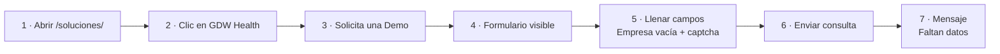

<div align="center">

# GeoGestión · QA Automation

**Prueba técnica QA para GoDoWorks**
Flujo *Soluciones → GDW Health → Solicita una Demo* automatizado con Playwright


</div>

---

## Contenido

- [Qué cubre](#qué-cubre)
- [Requisitos](#requisitos)
- [Instalación](#instalación)
- [Cómo ejecutar](#cómo-ejecutar)
- [El captcha "Soy humano"](#el-captcha-soy-humano)
- [Bugs encontrados](#bugs-encontrados)
- [Estructura del proyecto](#estructura-del-proyecto)
- [Por qué Playwright](#por-qué-playwright)
- [Si algo falla](#si-algo-falla)

---

## Qué cubre



| Prueba | Archivo | Qué hace |
|---|---|---|
| **CP-GDW-01** | `tests/e2e/solicitud-demo-gdw-health.spec.ts` | Recorre los pasos 1 a 7 del ejercicio. Cada paso es un `test.step` con su captura en el reporte. |
| **Regresión de bugs** | `tests/e2e/hallazgos-regresion.spec.ts` | Un test por cada bug encontrado. Están marcados como falla esperada: cuando el bug se corrija, Playwright avisa. |

> 🔒 Ninguna prueba envía datos reales: el envío del formulario (`/api/enviar`) se bloquea en todas las ejecuciones.

---

## Requisitos

- [Node.js](https://nodejs.org/) 18 o superior (recomendado 22 LTS)
- Google Chrome (si no está instalado, se usa el Chromium de Playwright)
- Git y VS Code con la extensión **Playwright Test for VS Code** (opcional, recomendada)

---

## Instalación

Abre una terminal en la carpeta local donde quieras guardar el proyecto y ejecuta:

```bash
git clone https://github.com/lennniex/geogestion-qa-automation.git
cd geogestion-qa-automation
npm install
npm run setup        # instala el Chromium de Playwright y ffmpeg (solo la primera vez)
code .               # abre el proyecto en VS Code
```

---

## Cómo ejecutar

| Comando | Para qué sirve |
|---|---|
| `npm run test:captcha` | ⭐ **Flujo completo (pasos 1 a 7)** con el navegador visible. El test se detiene para que marques "Soy humano" y luego sigue solo. |
| `npm test` | Flujo + tests de bugs sin ventana. El captcha queda sin marcar. |
| `npm run test:flujo` | Solo el flujo, sin ventana. |
| `npm run test:bugs` | Solo los tests de regresión de bugs. |
| `npm run test:ui` | Modo UI de Playwright para ver cada paso con línea de tiempo. |
| `npm run report` | Abre el reporte HTML de la última ejecución. |

Los resultados quedan en `reports/`: el reporte HTML de Playwright con capturas de cada paso y el trace cuando algo falla.

> ℹ️ Durante el paso 4 el test compara el título del formulario con el que pide el ejercicio. Hoy no coinciden, así que queda anotado como **BUG-GDW-002** en el reporte y el flujo sigue hasta el paso 7.

---

## El captcha "Soy humano"

El formulario usa un **hCaptcha real**, pensado justamente para que no lo marque un robot. Por eso el test no lo salta por código:

1. Corre `npm run test:captcha`.
2. Se abre Chrome y el test llena el formulario.
3. Cuando veas el captcha, marca **Soy humano** (tienes 3 minutos).
4. El test continúa solo con *Enviar consulta* y verifica el mensaje de error.

En un ambiente de QA que use la clave de prueba de hCaptcha (`10000000-ffff-ffff-ffff-000000000001`) el test lo marca solo:

```bash
# PowerShell
$env:HCAPTCHA_TEST_MODE="1"; npm run test:flujo
# bash
HCAPTCHA_TEST_MODE=1 npm run test:flujo
```

---

## Bugs encontrados

Detalle completo, con pasos, resultado esperado vs. obtenido y capturas, en **[`docs/reporte-bugs.html`](docs/reporte-bugs.html)** (descárgalo y ábrelo en el navegador). Las capturas están en [`docs/evidencias`](docs/evidencias).

| ID | Bug | Severidad | Prioridad |
|---|---|:---:|:---:|
| BUG-GDW-001 | Al dejar vacío "Nombre de la empresa" el error no dice qué falta ni avisa del captcha | 🟠 Media | 🔴 Alta |
| BUG-GDW-002 | El título del formulario no es el que pide el ejercicio | 🟠 Media | 🟠 Media |
| BUG-GDW-003 | El teléfono acepta letras y un solo dígito | 🟠 Media | 🔴 Alta |
| BUG-GDW-004 | El correo acepta direcciones incompletas como `info@godoworks` | 🟠 Media | 🟠 Media |
| BUG-GDW-005 | "Nombre completo" se da por lleno con solo espacios | 🟠 Media | 🟠 Media |
| BUG-GDW-006 | El aviso del captcha llega recién en el segundo intento | 🟢 Baja | 🟠 Media |
| BUG-GDW-007 | El botón "Conviértete en partner" se corta y aparece scroll horizontal | 🟠 Media | 🔴 Alta |
| BUG-GDW-008 | La ventana de WhatsApp se abre sola y tapa las tarjetas | 🟢 Baja | 🟢 Baja |
| BUG-GDW-009 | 2 errores de JavaScript en la consola en cada carga | 🟢 Baja | 🟢 Baja |
| BUG-GDW-010 | Muchas imágenes no tienen texto alternativo | 🟠 Media | 🟠 Media |
| BUG-GDW-011 | "Solicita una demo" del menú lleva a la página de inicio | 🟠 Media | 🟠 Media |
| BUG-GDW-012 | "Política de privacidad" no tiene enlace | 🟠 Media | 🔴 Alta |
| BUG-GDW-013 | Faltas de ortografía y mezcla de "tú" y "vos" | 🟢 Baja | 🟢 Baja |
| BUG-GDW-014 | Los nombres de las soluciones no están marcados como títulos | 🟢 Baja | 🟢 Baja |
| BUG-GDW-015 | Sin límite de caracteres, "Ciudad/País" mezclado y restos de otro captcha | 🟢 Baja | 🟢 Baja |

**Ambiente:** Google Chrome 155 · Windows 10/11 64 bits · sitio en producción · 21 de octubre de 2026.

---

## Estructura del proyecto

```
geogestion-qa-automation/
├── playwright.config.ts          # Chrome, idioma es-CO, capturas, trace y reportes
├── src/
│   ├── pages/                    # Page Objects
│   │   ├── BasePage.ts           #   comportamiento común y bloqueo de envíos
│   │   ├── SolucionesPage.ts     #   /soluciones/
│   │   ├── GdwHealthPage.ts      #   /gdw-health/
│   │   └── ContactFormPage.ts    #   formulario "Solicita una Demo"
│   ├── data/contactForm.data.ts  # datos del paso 5 y textos esperados
│   └── utils/                    # logger y escaneo de la página
├── tests/e2e/
│   ├── solicitud-demo-gdw-health.spec.ts   # flujo pasos 1 a 7
│   └── hallazgos-regresion.spec.ts         # un test por bug
├── docs/
│   ├── reporte-bugs.html         # reporte visual de los 15 bugs
│   ├── hallazgos.json            # datos de los bugs
│   └── evidencias/               # capturas con el error marcado
└── .github/workflows/            # ejecución en GitHub Actions
```

---

## Por qué Playwright

- **Espera sola a los elementos.** Antes de hacer clic o escribir espera a que el elemento esté visible y habilitado, así que no hace falta llenar el código de pausas.
- **Varios navegadores con el mismo código.** Chrome, Edge, Firefox y Safari (WebKit), además de emulación de celulares.
- **Control de la red.** Permitió bloquear el envío del formulario para probar validaciones en producción sin mandar datos reales.
- **Evidencia lista.** Capturas, video y Trace Viewer salen de la misma ejecución, justo lo que se adjunta a un bug en Jira.
- **Iframes sin complicaciones.** El captcha vive dentro de un iframe y Playwright lo maneja directamente.
- **Buenas herramientas.** Codegen, modo UI, extensión de VS Code y servidor MCP (`.vscode/mcp.json`) para explorar la página con IA.

Frente a Selenium se escribe mucho menos código de sincronización; frente a Cypress maneja varias pestañas, dominios e iframes sin trucos y además prueba en Safari.

---

## Si algo falla

| Síntoma | Solución |
|---|---|
| El navegador no abre o aparece `Executable doesn't exist ... ffmpeg` | Ejecuta `npm run setup`. El video viene apagado; para grabarlo usa `PW_VIDEO=1`. |
| `Chromium distribution 'chrome' is not found` | El proyecto usa Chromium si no encuentra Chrome. Para forzarlo: `PW_CHANNEL=chromium`. |
| Timeout en el paso 5 | El test espera 3 minutos a que marques "Soy humano". Si aparece un desafío de imágenes, resuélvelo y sigue. |
| Quiero ver el error completo | `npm run report` y abre el test en rojo: ahí están el mensaje, la captura y el trace. |

---

<div align="center">

Hecho por **Lennin Alexander Martinez** · Analista QA · [github.com/lennniex](https://github.com/lennniex)

</div>
